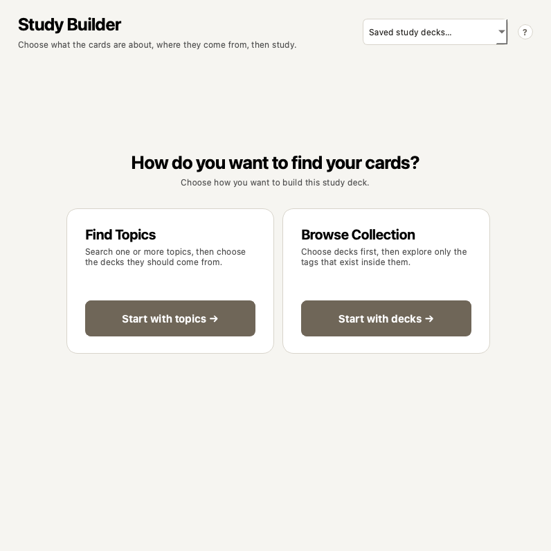
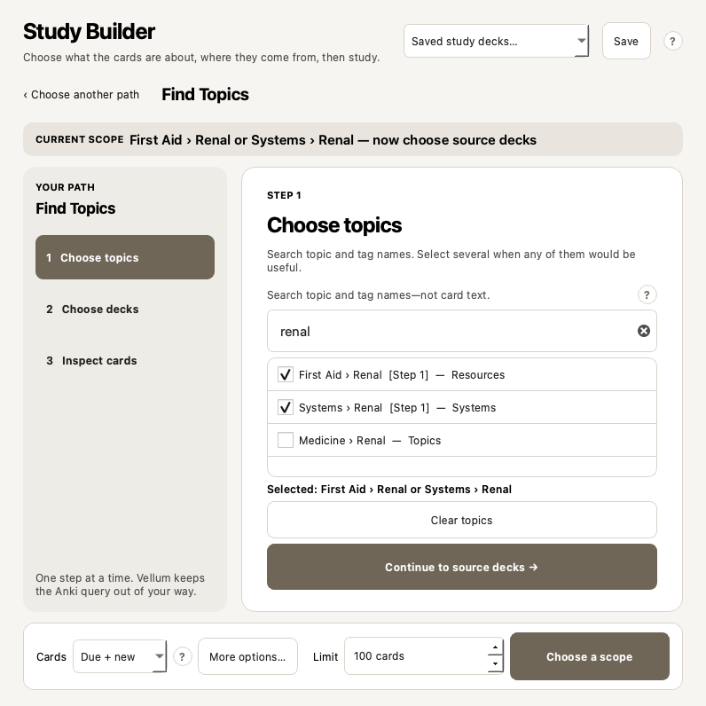
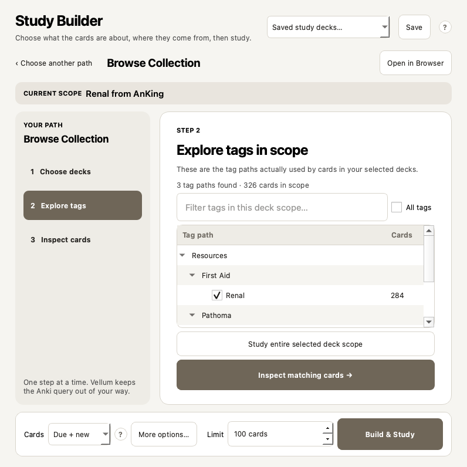

# Vellum for Anki

> **Anki remembers your cards. Vellum remembers your studying.**

[See the visual walkthrough](https://fateh-alam.github.io/vellum/) ·
[Install from AnkiWeb](https://ankiweb.net/shared/info/226947964) ·
[Download the latest release](https://github.com/Fateh-Alam/vellum/releases/latest) ·
[Give feedback](https://github.com/Fateh-Alam/vellum/issues/new/choose)

**AnkiWeb code: `226947964`**

I built Vellum because I was spending too much time in Anki's Browser trying to
combine medical topics, resource tags, parent decks, and subdecks. The cards were
already in the collection; getting the exact set I wanted was the annoying part.

Vellum is an Anki Desktop add-on that handles that setup. Its main feature,
**Study Builder**, turns a request such as:

> I want Renal or Cardiology cards, but only from AnKing or my Medicine deck.

into a scheduled, rescheduling-enabled native Anki filtered deck—without making
you construct Browser queries.

Vellum does **not** provide medical content, generate cards, replace FSRS, choose
answer ratings, edit your tags, or upload your collection. Anki remains the
owner of your cards and scheduling.



## The 30-second mental model

```text
Your existing cards
        ↓
Choose a topic/deck scope you understand
        ↓
Inspect ready, suspended, buried, and unavailable cards
        ↓
Vellum creates a temporary native filtered deck
        ↓
You answer normally with Anki and FSRS
        ↓
Cards return to their home decks when the session is safely finished
```

In other words: Vellum picks the cards; Anki still handles the studying.

## Study Builder: two understandable routes

### Route 1 — Find Topics

Use this when you know the subject you want to study.

1. Search only topics and tag paths—for example `renal`.
2. Select one or several topics. Multiple topics are alternatives: **Renal OR
   Acid–Base**.
3. Vellum shows only decks and subdecks that actually contain matching cards.
4. Choose one or several source decks. Multiple source decks are alternatives:
   **AnKing OR Medicine**.
5. Vellum combines the two sets:

   ```text
   (Renal OR Acid–Base) AND (AnKing OR Medicine)
   ```

6. Inspect exact availability and a few card previews.
7. Choose a limit and select **Build & Study**.



### Route 2 — Browse Collection

Use this when you know which deck should supply the cards.

1. Choose a parent deck or exact subdeck from a proper deck tree.
2. Checking a parent includes its descendants. The disclosure arrow only opens
   the parent; it does not select it.
3. Vellum calculates the hierarchical tags actually used by cards inside that
   deck scope.
4. Browse Resources, Systems, First Aid, Pathoma, or generic tag paths without
   seeing unrelated tags from the rest of the collection.
5. Checking a parent tag includes descendants. Choosing a specific child removes
   a redundant selected ancestor.
6. Inspect availability, choose a limit, and build.



### What the preview means

| Bucket | Meaning |
|---|---|
| **Ready** | The card can enter this filtered deck now. |
| **Suspended** | It remains excluded unless you explicitly enable and confirm unsuspension. |
| **Buried** | Vellum reports it, but it cannot enter the filtered deck. |
| **In another filtered deck** | Vellum reports it and refuses to steal it from that deck. |

Preview snippets are inspect-only and ephemeral. They are not stored in Vellum's
database, recipes, logs, diagnostics, or Debriefs.

### Common Study Builder controls

- **Cards:** Due + New, Due, New, or All.
- **Limit:** 100 cards by default; a numeric limit is required.
- **Order:** due first, relative overdueness, most lapses, oldest seen, added
  order, or random.
- **Avoid sibling cards:** optionally select at most one card from each note.
- **New-card share:** optionally request a due/new proportion; shortages are
  backfilled from the other bucket.
- **Unsuspend and include:** off by default and separately confirmed.
- **Open in Browser:** hands the exact compiled scope to Anki's Browser when you
  need full card management.
- **Saved study decks:** recipes store your selectors, not permanently occupied
  filtered decks. Each run re-evaluates the current collection.

## Will Vellum damage my collection?

No software can honestly promise it will never contain a bug. Vellum is designed
with a narrow mutation boundary, exact ownership checks, compensating rollback,
and disposable-collection qualification. Keep Anki's normal automatic backups
and make occasional manual exports of important collections.

### What Vellum may change

- It creates a uniquely named temporary **native Anki filtered deck**.
- Answers made in that scheduled filtered deck update scheduling normally,
  because Anki and FSRS process them.
- If—and only if—you enable **Unsuspend and include**, Vellum shows the exact
  count, asks for confirmation, and permanently unsuspends only the limited card
  IDs chosen for that run.
- It writes Vellum-owned history, recipes, timing, and deck manifests to a
  separate local SQLite database under the add-on's Anki-preserved
  `user_files/` directory.

### What Vellum does not change

- It does not delete your notes or cards.
- It does not rewrite fronts, backs, note fields, or media.
- It does not rename, merge, add, or remove your tags.
- It does not change Anki's collection database schema.
- It does not replace FSRS or calculate replacement intervals.
- It does not silently unbury cards or take cards from another filtered deck.
- It does not upload your collection or send telemetry.

### Build failure and cleanup behavior

Immediately before building, Vellum re-evaluates the definition, counts,
ordering, limit, sibling policy, due/new share, and activation eligibility.

If filtered-deck creation fails before study begins, Vellum removes only the
newly created identity-checked deck and re-suspends exactly the cards activated
for that attempt. It will not delete a deck when the saved ID/name ownership no
longer matches.

Natural completion or explicit **Finish** returns remaining cards home and
removes the exact Vellum-owned temporary deck. An interrupted, non-empty deck
remains resumable. Only one unfinished Vellum-generated study session may exist
at once; Vellum offers Resume, Finish, or Abandon instead of quietly creating
overlapping sessions.

## Why AnKing V12 benefits from this

AnKing is primarily organized with hierarchical tags because a card can relate
to several systems, resources, and exams while living in only one deck. Vellum
detects the locally installed hierarchy instead of assuming one frozen V12 tag
snapshot.

When present, it exposes human-facing structures such as:

- Step 1, Step 2, and Step 3 containers;
- Systems and subjects;
- First Aid, B&B, Pathoma, Sketchy, Bootcamp, Pixorize, and other detected
  resources;
- yield tiers and Step overlap/relevance tags;
- resource-specific chapter and video paths.

Parent selections include descendants. Deterministically equivalent Step copies
can appear as one visible row while their exact raw backing tags are preserved
for compilation and recipes. Maintenance/update/duplicate tags stay out of the
ordinary view but remain discoverable under **All tags**.

Vellum also works with ordinary parent/subdecks, generic hierarchical tags, flat
tags, decks without tags, Basic, Cloze, Image Occlusion, and custom note/card
types.

## Everything else Vellum adds

- **Context** — an optional Reviewer sidebar showing the current topic hierarchy
  and local topic evidence.
- **Recovery** — a Quick, Standard, Full, or Custom topic repair session built
  through Anki's filtered-deck flow.
- **Time Machine** — choose available time and deck groups; Vellum estimates a
  bounded queue using local timing evidence and safe fallbacks.
- **Session HUD** — quiet progress, active/elapsed time, pace, and ETA during a
  Vellum session.
- **Resume** — continues an interrupted generated session truthfully.
- **Return Ramp** — after time away, shows the real workload and suggests smaller
  bounded sessions.
- **Backtrack** — read-only access to the previous card/topic without answering,
  undoing, or changing scheduling.
- **Mind Notes** — private topic-linked text you deliberately write for a future
  encounter.
- **Session Debrief** — cards, active time, rating distribution, topic error
  clusters, Mind Note activity, and an optional handoff to your future self.
- **Commands & Help** — an offline guide with native shortcut labels, scopes,
  enabled states, and conflict reporting.

Every module can be disabled independently. Topic Health is opt-in and explicitly
labeled as a workflow heuristic—not a mastery score.

## Privacy

Vellum has no account, telemetry, analytics SDK, cloud backend, API keys, or
external data requests.

It never stores card question/answer text, note fields, media, Study Builder
snippets, rendered content, suggestion counts, or zero-result diagnostic probes.
It may store identifiers, timings, answer ratings, topic metadata, exact
generated-deck manifests, user-selected recipe selectors, and text deliberately
written in a Mind Note or handoff.

Diagnostics redact card/note IDs, profile paths, tag names, Mind Note text, and
handoff text. Read the complete [privacy and data guide](docs/PRIVACY.md).

## Install

### AnkiWeb — recommended

1. In Anki Desktop, open **Tools → Add-ons → Get Add-ons…**.
2. Enter **`226947964`**.
3. Install and restart Anki.
4. Complete the five-step Getting Started guide.

AnkiWeb installations are offered updates through Anki's add-on updater.

### GitHub file

1. Download `vellum-1.1.0.ankiaddon` from the
   [latest release](https://github.com/Fateh-Alam/vellum/releases/latest).
2. Open **Tools → Add-ons → Install from file…**.
3. Select the file and restart Anki.

A manually installed GitHub file is not attached to the AnkiWeb listing and must
be updated manually.

Vellum 1.1.0 targets Anki **25.09.4 or newer** and was locally qualified on macOS
with Anki 25.9.4 and 26.5. Native Windows-compatible source is present, but the
real Windows 11 matrix remains pending. Linux is not live-qualified for 1.1.0.

## First use

Open Vellum from Anki's **Builder** top-bar item, **Vellum → Build Study Deck…**,
Home, Overview, or the default `Ctrl+Shift+B` shortcut. The shortcut is
conflict-checked and displayed using your operating system's native notation.

The one-time Getting Started guide explains privacy and scheduler boundaries,
lets you choose modules atomically, detects topic roots, and shows actual
workflow entry points. Reopen it with **Vellum → Getting Started…**. The complete
offline guide is under **Vellum → Commands & Help…**.

## Qualification evidence

The v1.1.0 qualification run included:

- 162 unit tests;
- Python compilation and Reviewer JavaScript syntax checks;
- deterministic package and archive-integrity checks;
- a 50,000-tag performance fixture;
- Anki API compatibility checks for 25.9.4 and 26.5;
- disposable Anki-core validation of availability, activation rollback,
  rescheduling, parent/subdeck behavior, original home decks, and exact cleanup;
- native light/dark Qt, narrow-window, larger-text, tooltip, tutorial, and
  keyboard-focused smoke captures;
- isolated real Anki 26.5 desktop startup/module checks on macOS.

These checks do not prove compatibility with every third-party add-on or another
operating system and are not presented as such. See
[Development and release checks](docs/DEVELOPMENT.md).

## Development

Vellum's core, builder, topic, Recovery, session, and timing logic remains
importable without Anki. Qt and WebView dependencies stay at the integration
edge.

```bash
python3 -m unittest discover -s tests -t .. -v
env PYTHONPYCACHEPREFIX=/tmp/vellum-pycache python3 -m compileall -q .
node --check ui/assets/vellum.js
python3 scripts/performance_smoke.py
python3 scripts/build_package.py
python3 scripts/release_check.py
```

The Anki-core and Qt scripts must be run from outside the repository using
Anki's bundled Python and disposable collections.

## Support and responsible reports

Read [Troubleshooting](docs/TROUBLESHOOTING.md) first. If the issue remains,
export a redacted diagnostic from **Vellum → Settings → Data**, check it, and
choose the right place to respond:

- [Report a bug](https://github.com/Fateh-Alam/vellum/issues/new?template=bug_report.yml)
- [Raise a collection-safety concern](https://github.com/Fateh-Alam/vellum/issues/new?template=collection_safety.yml)
- [Request a feature](https://github.com/Fateh-Alam/vellum/issues/new?template=feature_request.yml)
- [Leave general feedback or ask a question](https://github.com/Fateh-Alam/vellum/discussions)

Do not attach your collection, card content, Vellum database, Mind Notes,
handoffs, or raw profile paths. Report security/privacy vulnerabilities through
[GitHub's private vulnerability-reporting form](https://github.com/Fateh-Alam/vellum/security/advisories/new).

Vellum is not affiliated with Anki, AnkiHub, or AnKing.
